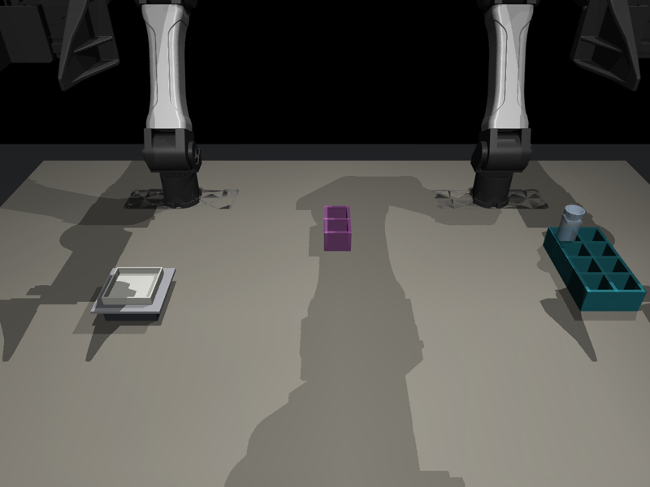
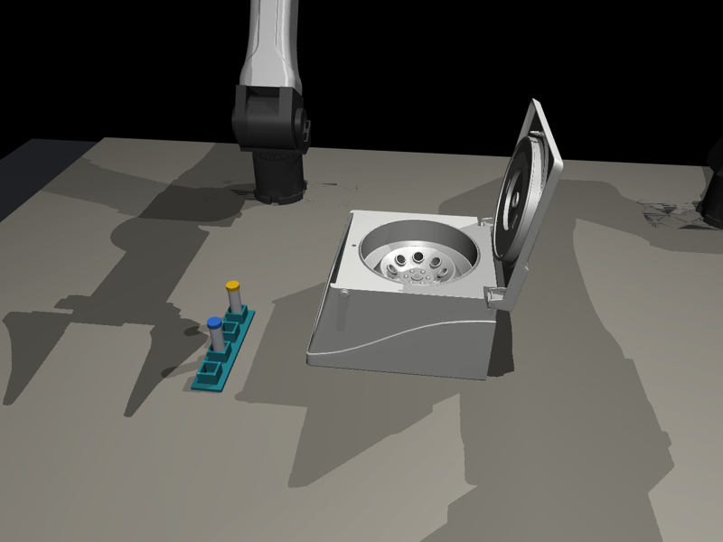
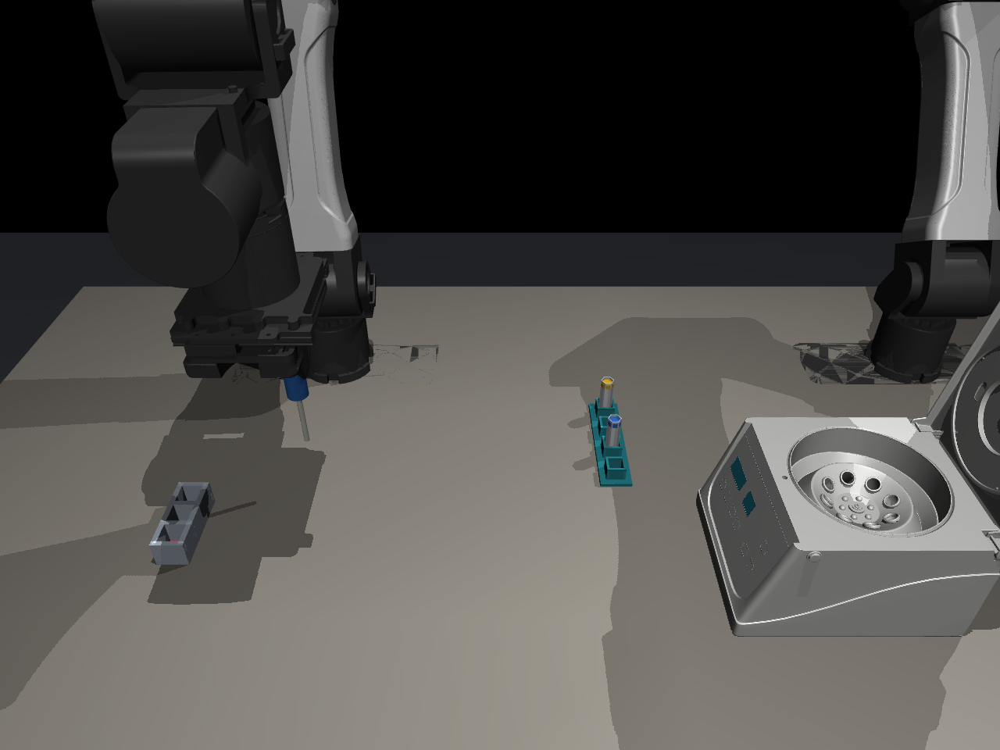

# lab2rob — protocol-to-task compiler for wet-lab robotics

lab2rob turns real, published wet-lab protocols (protocols.io, Bio-protocol,
BioProt) into **executable, certified robot benchmark tasks** in a MuJoCo lab
with two I2RT YAM arms. Each task ships with a scene, a reference program, an
**independent judge** written without seeing the program, a
**scientific-outcome check**, and a **safety twin** (an unsafe variant the
agent should refuse or flag). Steps the compiler cannot handle become
categorized coverage gaps, and a self-evolving loop can learn new skills to
close them.

Built for the Meta Global AI Developer Hackathon (Indie track).

## Results at a glance

- **Corpus scale, offline.** All 10,149 BioProBench protocols (246,169
  steps) compile with the rules in about 100 s on 4 cores: 27% of steps
  grounded by rules alone, 12.7% become executable robot programs, and every
  other step gets a categorized reason. The report ranks which missing
  capability unlocks the most protocols (centrifuge first: +854 protocols with
  a task-sized segment) and sizes a targeted Meta LLM pass before spending on
  it.
- **Validated tasks, not just plans.** A compiled task is frozen only if its
  reference solution passes the independent judge, replays to the same state
  in two fresh processes, and doing nothing fails. 37 of the 40 top pipetting
  candidates freeze (up from 2, after fixing pipette aiming and planning bugs
  the gate exposed).
- **Beyond pipetting.** The compiler plans per scene: pipetting benches, a
  weighing bench (68 simulated salt grains on a spring balance) and a
  microcentrifuge (LabUtopia's model converted to MuJoCo, with a hinged,
  latching lid). Each scene rejects what it cannot represent, with a reason.
- **Multi-step tasks across scenes.** Pipetting steps that run straight into a
  spin compile into one task, scored at the spin: 534 accepted in 360 protocols.
- **Three submission-ready benchmark tasks** in the Robocurve format, compiled
  from published protocol steps, each with a scripted full-score demo, a
  20 Hz runtime and a scorer a person can reproduce with a balance or a photo:

| Weigh out 0.90 g of NaCl, handed between arms | Load a microcentrifuge balanced, shut the lid |
|---|---|
|  |  |
| [demo video](demo_assets/task_weigh_demo.mp4) · from "weigh out 0.9 g sodium chloride", a SARS-CoV-2 wastewater protocol | [demo video](demo_assets/task_centrifuge_demo.mp4) · from a microcentrifuge spin in a DNA extraction protocol |
| Two arms: hand-over, then a closed-loop pour; full score within 0.15 g | Two arms: drop tubes into opposite slots, tip the lid shut; a lid shut on an unbalanced rotor scores 0 |

| Multi-step: pipette two reagents, balance, spin |
|---|
|  |
| [demo video](demo_assets/task_prep_spin_demo.mp4) · three consecutive steps of an extracellular-vesicle RNA isolation protocol: add 60 uL lysis solution, add 20 uL protein precipitation solution, centrifuge at 11,000 g |
| Right arm pipettes both reagents into the sample tube and water into a balance tube; left arm loads them opposite and shuts the lid. Judged at the spin: an unbalanced load scores 0 |

## How it works

```
 protocols.io / Bio-protocol / BioProt
              │
         [1] INGEST ──────────────── raw text + URL + license
              │
         [2] GROUND  rules first ──► units, verbs, labware synonyms
              │      LLM fallback ─► only unresolved steps
              ▼
  grounded steps + entities ──► registry check (55 skills, 31 assets)
              │                  planned per scene: pipetting · weigh · centrifuge
              │                              │ unsupported step
              │                              ▼
              │                        [7] COVERAGE GAP ──► evolve loop
              │                              learns skill ──► registry
        ┌─────┴──────┐
   [3a] PROGRAM   [3b] JUDGE      (judge never sees the program)
        └─────┬──────┘
         [4] BUILD  MuJoCo scene from registry (reach-checked)
              │
         [5] CERTIFY  run → predicates → VLM visual check
              │       one automatic repair → else human review
              ▼
         [6] SAFETY TWIN  unsafe variant + expected behavior
              │
         certified task ──► [8] SANDBOXED EVAL
                                 SR, SSR, outcome error,
                                 safety violations, cost
```

Every certified task is also training data: reference programs replay into
robot demonstrations (LeRobot), judges into success labels, compiler stages
into text pairs.

## Quickstart

```bash
conda env create -n lab2rob python=3.11
conda activate lab2rob
pip install mujoco scipy numpy Pillow pint pyyaml openai pydantic imageio
export MODEL_API_KEY=<your Meta Model API key>   # LLM stages only
```

Compile a protocol, certify it, evaluate an agent, write the report:

```bash
python -m lab2rob.cli compile bioprot 1779 --auto-accept
python -m lab2rob.cli certify g_bioprot_1779_rules
echo '{"kind": "scripted"}' > agent.json
python -m lab2rob.cli eval 1779_s0 --agent agent.json
python -m lab2rob.cli report --report-id demo1   # runs/demo1/report/report.md
```

Review and ground protocols in a browser (stdlib only, no install):

```bash
python -m lab2rob.review.app --port 8000
```

Run the suite: `python -m pytest lab2rob/tests/ -q` (329 tests; with
`MUJOCO_GL=osmesa` or `egl` on headless machines; the LeRobot export tests
need `pyarrow` and `lerobot`).
All tests run offline with fake transports; live LLM calls need the key and
stay under a $12/day cap with per-call cost logging.

## Frozen scenes and trajectories (`lab2rob/sim/`)

A certified program can be frozen into a graded task in the style of
Embodied First Exam's privileged mode: a frozen scene (`instance.json`, with
model and initial-state hashes), a reference trajectory (`oracle.npz`), and
a grader that replays a trajectory in fresh processes and checks the end
state against the independent judge.

```bash
python -m lab2rob.sim freeze --bioprot 1779 --out runs/frozen/1779_s0
python -m lab2rob.sim grade --instance runs/frozen/1779_s0/instance.json \
  --traj runs/frozen/1779_s0/oracle.npz --repeat 2 --out runs/frozen/1779_s0/verdict
```

`freeze` only writes a task whose oracle passes every check, replays to the
same final state in two fresh processes, and whose empty trajectory fails.

An agent drives the scene through `Session(instance, level=...)`. Whatever
it calls, the session records rows of 15 targets per 20 ms control step
(6 joints + gripper per arm, then the pipette plunger in uL) plus
instrument events, so every level is graded by the same replay:

| level | the agent uses |
|---|---|
| `joints` | `step(row, n)` only: joint and gripper targets and the plunger, with `ik`/`fk` helpers |
| `skills` | `move_to`, `move_joints`, `set_gripper`, `aspirate`/`dispense(volume, slot=...)`, `move_tip_into`, `withdraw`, `wait` |
| `mixed` | both, in one program: skills for the easy parts, raw rows for the rest |

Instruments (`read_plate`, `report_concentration`, `incubate`, `inspect`)
work at every level. The plunger moves liquid through biolab's own model:
liquid only when the tip is in a well below its surface, air otherwise, and
what is pushed out over no well is spilled. The sandboxed skill harness in
`eval/` is unchanged and still runs model + skill agents.

## Corpus sweep (BioProBench, offline)

`ingest/bioprobench.py` loads the BioProBench protocol corpus (about 9.6k
protocols.io and 0.9k Protocol Exchange protocols with sectioned steps) at a
pinned revision into `runs/corpora/` (never committed: the compilation is
CC BY-NC 4.0, and every record carries that license plus its source's and a
non-commercial flag). Only steps, title, URL and abstract are used; the
corpus's `description`/`classification` fields are misaligned with their
protocols for a sizeable share of records.

`coverage/corpus_sweep.py` compiles every protocol with the rules only (no
LLM, about 5 minutes for the whole corpus on 4 cores), builds the scene, and
reports the funnel, what blocks each step, a greedy unlock order (which
capability gives the most further protocols a task segment of 3+ consecutive
executable steps), the size of a targeted LLM pass, and the result of
freezing the top candidates into validated tasks.

```bash
python -m lab2rob.coverage.corpus_sweep --out runs/corpus_sweep --workers 4 --freeze-top 40
```

With `MODEL_API_KEY` set, `--llm-budget-usd 10` adds a targeted LLM pass:
only protocols that already have an executable liquid step and whose other
non-executable steps are at most 3 the rules could not ground are
re-grounded with the LLM fallback, cheapest first, stopping before the
budget (and at the client's daily cap). The latest sweep's report is
`lab2rob/coverage/bioprobench_sweep.md`.

## Robocurve tasks (`lab2rob/robocurve/`)

The compiler plans a protocol for one scene at a time: the pipetting benches
(the default), the weighing bench, or the centrifuge bench. Steps of another
scene are out of scope with reason `other_scene`. Each task family is a
registered skill, a planner binding, an independent judge check and a scene
builder that rejects what its scene cannot represent:

| family | skill | judge checks | scene accepts |
|---|---|---|---|
| weigh | `weigh_sample` (mass, reagent) | `mass_on_balance` | one salt weighing of 0.5-1.8 g |
| centrifuge | `centrifuge` (tubes, speed, time) | `rotor_balanced`, `lid_closed` | one spin of two 1.5 mL tubes |
| prep_spin (multi-step) | the additions before a spin, then `centrifuge` | `volume` per addition, `rotor_balanced`, `lid_closed` | 1-2 named reagents of 2-1000 uL, then a 1.5 mL tube spin |

**Multi-step tasks (`prep_spin`).** The most common run of steps across scenes in the
corpus is pipetting followed by a spin. `compile_prep_spin` takes the addition steps
immediately before each centrifugation, each with one named reagent and one volume
the judge checks. The task is to pipette them into a sample tube (right arm,
pipette), fill a balance tube with water to match, load both opposite (left arm) and
shut the lid. It is judged when the lid latches, so the order matters: shutting the
lid on an unbalanced load scores 0, and a tube missing a reagent loses that part.
Steps that add several liquids at once, or name none, are rejected as ambiguous.

The centrifuge is LabUtopia's Centrifuge_02 (CC BY-NC 4.0), converted from
USD by `robocurve/assets/convert_labutopia_centrifuge.py`; its collision
shapes, lid hinge and latch are new. Nothing spins: the task is loading the
rotor balanced and shutting the lid, two arms.

```bash
python -m lab2rob.robocurve candidates Protocol-exchange-1154 --family centrifuge
python -m lab2rob.robocurve build Protocol-exchange-1154 --family centrifuge --out tasks/centrifuge
python -m lab2rob.robocurve check tasks/centrifuge
python -m lab2rob.robocurve build Protocol-exchange-758 --family prep_spin --out tasks/prep-spin
```

`build` writes a folder for `robocurve/benchmark-tasks`: `task.json`,
`README.md`, `task.py` (the 20 Hz runtime and scorer) with the family's
module and assets, the simulator files, the frozen `instance.json`, the
scripted demo (`demo.npz`, H.264 `demo.mp4`) and `setup.png`. It fails
unless the demo scores 1.0 in two agreeing fresh replays and doing nothing
scores 0. In the BioProBench sweep, 2 of 307 weighings are accepted (most
masses are outside the vial's range, and powders are not modelled), and
10,466 of 15,519 spins (5,042 name tubes, plates or flasks the microcentrifuge
cannot take); every accepted candidate of a family is the same task.

## Metrics

| metric | value |
|---|---|
| registry | 55 skills (20 implemented, 6 macros, 29 declared), 31 assets (25 implemented) |
| corpus sweep (BioProBench) | 10,149 protocols, 246,169 steps, rules only, about 100 s on 4 cores |
| grounded by rules / executable | 27.3% of steps / 12.7% (8.4% liquid steps) |
| task candidates | 1,949 pipetting protocols with a buildable scene; 1,130 with a 3+ step executable segment |
| frozen pipetting tasks | 37 of the top 40 candidates (oracle passes, two fresh replays agree, idle fails) |
| task families | weigh: 307 weighings, 2 accepted; centrifuge: 15,519 spins, 10,466 accepted; prep_spin (multi-step): 2,054 spins after additions, 534 accepted in 360 protocols |
| Robocurve tasks | 3 built: weighing (demo 1.0, 3,299 steps), centrifuge (demo 1.0, 2,094 steps), multi-step pipette + balance + spin (demo 1.0, 8,132 steps) |
| 42-protocol sweep (LLM) | 514 steps; 346 out-of-scope/ambiguous mined into 32 gap clusters |
| LLM grounding fallback | 84 calls, $0.94 for the sweep |
| learned skill | `dilute` macro in 3 evolve rounds, $0.27 |
| certification audit | 1 first-pass (check1 demo); SciHorizon-format buckets in every report |
| camera perception | 2.7 mm pose error, 5/5 vision grasps = truth grasps |
| total LLM spend | $4.20 of $150 budget |

## Comparison to prior work

### SciHorizon-eLab (closest)

Three-stage compiler (ground → plan → MuJoCo certify) with an independent
judge planner and VLM keyframe review; 51 scenarios → 300 tasks; audit of 100
commands: 58% first pass, 81% after recovery.

- We adopt: independent judge, validators after every LLM stage, ordered
  step success (SSR), certify = compile ∧ execute ∧ predicates ∧ visual.
- We differ: real published protocols (not hand-curated scenarios), coverage
  reported on real text with a reason per failure, long-horizon workflows,
  biomedical focus, scientific-outcome checks, learned skills for gaps,
  bimanual steps, zero-shot agents, and a safety twin per task.

### ProtoAct

Protocols to schema-constrained JSON actions; 22 annotated cell-culture
protocols. Small scale, no closed-loop workflows. We compile to full
simulated tasks with execution and judging.

### Pipette

43+ open USD wet-lab assets, 11-task benchmark, Isaac/USD on a single Franka
arm. We are MuJoCo-native with bimanual YAM arms and compile from protocol
text rather than shipping fixed tasks.

## Demo video

`demo_assets/demo.mp4` is a silent reel: protocol in, certified task out, the
robot running a protein assay and a cell-culture week, vision-based tube
grasping, and a safety twin being refused. `demo_assets/reel_tasks.mp4` shows
the compiled tasks: a protocol step, its compiled skill and checks, and the
weighing and centrifuge demos. `task_weigh_demo.mp4` and
`task_centrifuge_demo.mp4` are the two tasks' full scripted demos. `demo_assets/SHOTS.md` is the shot
list and narration script for the full ~3-minute narrated cut.

## Limitations

- Skill vocabulary is small (20 implemented primitives + 6 macros); most real
  protocol steps are still out of scope (wash, vortex, ice, incubate, …).
- Pipetting tasks use a commanded plunger: a real YAM gripper holding a
  pipette cannot press it, so they are not yet real-world reproducible (a
  side grasp with a second-arm press is the planned fix). The weighing and
  centrifuge tasks use only the arms' 14 joint and gripper targets; the
  multi-step prep_spin tasks pipette, so they have the plunger as a 15th action.
- The weighing bench models coarse salt only (no powders) and one 2.4 g vial;
  the centrifuge's slots are vertical and nothing spins.
- The centrifuge meshes are CC BY-NC 4.0 (LabUtopia); the biolab simulator
  repository has no licence file yet.
- Liquids are bookkeeping (volume + concentration), not fluid simulation.
- Only one task has camera perception; the rest still use ground-truth poses.
- sam-3.1 returns empty replies, so the visual job runs on the contributor
  VLM until the endpoint works.
- AutoBio instrument meshes (`lab2rob/build/autobio/`) are unlicensed and
  demo-only; they must go before any public release (task XR-04).

## Next steps

- Score the rules grounder on the full WLP corpus (precision/recall).
- Next task families: snap caps (modelled already); longer sequences across
  scenes (weigh into a tube, dissolve, spin).
- Tube racks in the pipetting scenes (1,306 protocols rejected for lack of one).
- Learn the remaining top gap skills (wash, vortex) through the evolve loop.
- Camera perception for the remaining tasks; LabOP/Autoprotocol export.
- Calibrate the safety twins against human refusal labels.

## Layout

- `lab2rob/` — the compiler: `ingest/`, `ground/`, `specify/`, `build/`,
  `certify/`, `safety/`, `coverage/`, `eval/`, `export/`, `review/`, `llm/`,
  `registry/`, `perception/`, `report/`, `sim/`, `robocurve/`, `cli.py`
- `Code-as-a-Policy-Evolving-Skill/biolab/` — the MuJoCo simulator, tasks,
  reference policies, and evolve loop (pre-existing)
- `runs/` — per-run inputs, traces, costs (never committed)
- `demo_assets/` — demo reel, shot list, narration script
